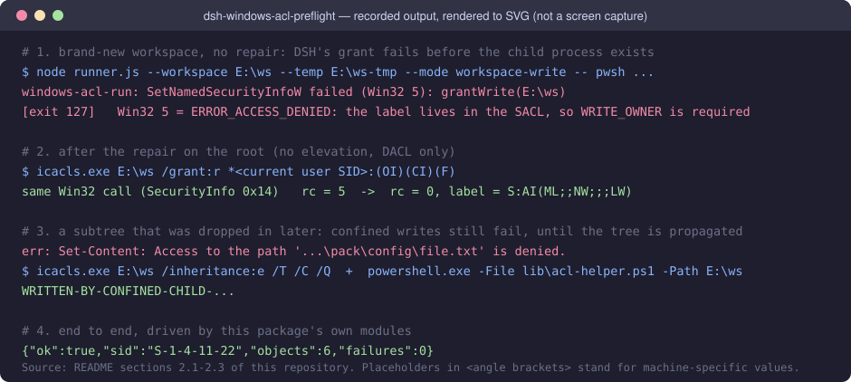

[English](README.md) | 简体中文

# dsh-windows-acl-preflight

[](https://github.com/arr0g/dsh-windows-acl-preflight/actions/workflows/test.yml)
[](LICENSE)
[](README.zh.md#9-已知限制)
[](.github/workflows/test.yml)

让**新工作区开箱即用**：不用再手工修 ACL，`pwsh` 一开就能跑；
连工作区里**早就存在、后来才被沙箱纳入**的子目录（典型：解压好的整合包目录）也能写。

---

## 1. 它解决的问题

Windows 上，工作区模式（`workspace-write`）的会话里有**两类**会弹审批/直接失败的场景。

### 问题 A：新工作区里任何 pwsh 命令都跑不了

```
Error: SetNamedSecurityInfoW failed (Win32 5): grantWrite(E:\my-workspace)
```

（Win32 5 = `ERROR_ACCESS_DENIED`。失败发生在 DSH 生成沙箱授权那一刻，**子进程还没被创建**，
所以任何命令都跑不了，只能靠把权限提到 `danger-full-access` 绕过——这不是修复。）

**根因**：DSH 的 Windows 沙箱 runner（`@deepseek-ai/dsh-sandbox-windows-acl`）用**一次**
`SetNamedSecurityInfoW` 同时写三样东西：

1. 给沙箱子进程的能力 SID 加写权限 ACE（mask `0x110156`）；
2. 给 Everyone 加 `DELETE_CHILD` 拒绝 ACE；
3. 写入 Low 完整性标签——**标签在 SACL 里**。

第 3 步决定了整次调用需要目录上的 `WRITE_OWNER`。而**属主只隐含 `READ_CONTROL` 和
`WRITE_DAC`，从不隐含 `WRITE_OWNER`**。直接建在盘符根目录下的新文件夹（例如 `E:\新工作区`）
从父目录继承到的只是 `NT AUTHORITY\Authenticated Users:Modify`，于是整次调用失败，
整个工作区的 pwsh 全部不可用。

**修法（一行、免提权、只动 DACL）**：

```
icacls.exe <目录> /grant:r *<当前用户SID>:(OI)(CI)(F)
```

能免提权成功，是因为**调用者本来就是该目录的属主**（属主隐含 `WRITE_DAC`，这恰好是改 DACL
所需的权限）。加上 `(OI)(CI)` 让它可继承，于是这一条命令同时解决下面问题 B 的前置条件。

### 问题 B：能跑命令了，但写不进"早就在那儿的"子目录

受限子进程是一个 **WRITE_RESTRICTED + Low 完整性**的令牌，它只能在同时满足
「能力 SID 出现在 DACL 里」且「对象带 Low 标签」的位置写入。而 DSH 的授权只作用于
**工作区根目录**：

- `SetNamedSecurityInfoW` 不会把新加的可继承 ACE 下发到**已存在**的子对象；

- 于是"工作区建好后、才被放进来/解压出来的"子树（例如 `E:\my-workspace\vendor-pack`，325 目录 / 2005 文件）
  既没有能力 SID ACE 也没有 Low 标签 —— 写入被系统拒绝，
  
  ```
  Set-Content: Access to the path 'E:\my-workspace\vendor-pack\...' is denied.
  ```
  
  模型只能申请提权，于是**又弹一次审批**。工作区建好之后**新建**的子目录不受影响（它们正常继承）。

**修法（两步，都免提权）**：

```
icacls.exe <工作区根> /inheritance:e /T /C /Q          # 把 DACL（能力 SID + 拒绝 ACE）下发到整棵已存在的子树
powershell.exe -File lib\acl-helper.ps1 -Path <根>     # 用 P/Invoke 给整棵树补 Low 标签（icacls 做不到）
```

> `icacls /setintegritylevel` 对子对象一律 `Access is denied.`（rc 仍为 0），且**不能**用来补标签；
> 标签必须用 `SetNamedSecurityInfoW(..., LABEL_SECURITY_INFORMATION, ...)` 逐个对象写，故本包自带 helper。
> 标签 ACE 必须是**可继承**形式 `S:(ML;OICI;NW;;;LW)`，否则到不了已存在的子对象。

---

## 2. 实测证据

### 2.1 根目录授权（问题 A）

在一个**新建的盘符根目录**（`E:\acl-raw`，即"新工作区"的等价物）上，用与被测
runner 完全相同的 Win32 调用（`SetNamedSecurityInfoW`，SecurityInfo `0x14` = DACL|LABEL）复现：

| 步骤                                | 结果                                      |
| --------------------------------- | --------------------------------------- |
| 未修复，直接调用                          | `rc = 5`（ERROR_ACCESS_DENIED），标签仍为 `''` |
| 运行本插件的修复（`icacls /grant:r`，退出码 0） | `repair: {"ok":true}`                   |
| 同一次调用重试                           | `rc = 0`，标签变为 `S:AI(ML;;NW;;;LW)`       |



### 2.2 用 **DSH 自己的 runner** 跑通三个舞台（问题 A + B）

把 `dsh-sandbox-windows-acl/lib/runner.js` 原样取出来当黑盒执行
（`--workspace <ws> --temp <temp> --mode workspace-write -- pwsh ...`，standalone 模式即 DSH 授权失败的那条路径）：

| 舞台  | 场景                                                                | 结果                                                                                                               |
| --- | ----------------------------------------------------------------- | ---------------------------------------------------------------------------------------------------------------- |
| A   | 全新工作区，不修                                                          | runner 退出 **127**，stderr 原文：`windows-acl-run: SetNamedSecurityInfoW failed (Win32 5): grantWrite(E:\ws)` |
| B′  | 根已修；子目录 `pack` 用 `icacls /inheritance:d` 断掉继承（= 上面那种"后来才被放进来"的子树的真实形状） | `confine` 成功，但子进程写文件被拒：`err: Set-Content: Access to the path '…\pack\config\file.txt' is denied.`                |
| C   | 再跑本包的树传播（`/inheritance:e /T` + 标签 helper）                         | 同一受限子进程写入成功，文件内容 `WRITTEN-BY-CONFINED-CHILD-…`                                                                   |

### 2.3 用**本包自己的模块**驱动的端到端

下表是一个开发脚本的实录输出，该脚本在 DSH 受控会话里直接 `import` 本包的
`lib/repair.js` / `lib/propagate.js`，对一棵断继承的树按
真实顺序执行（修根 → 第一次受限调用触发 DSH 授权 → 传播 → 再调用）：

| 步骤                           | 结果                                                                            |
| ---------------------------- | ----------------------------------------------------------------------------- |
| 1 `repairer.repair(ws)`      | `{"ok":true,"dir":"E:\\ws-e2e"}`                                         |
| 2 受限写                        | 目标仍是 `ORIGINAL`（**被拒**）                                                       |
| 3 `propagator.propagate(ws)` | `{"ok":true,"sid":"S-1-4-11-22","objects":6,"failures":0,"ms":1}` |
| 4 受限写                        | `WRITTEN-AFTER-PROPAGATION`                                                   |

即：**"修根 + 传播"就是让受限子进程能写既有子树的充分条件**。

---

## 3. 工作方式

插件挂载后，在**每一次受限命令真正执行之前**把目录修好，共四条路径；
第 3 条除了修根，还在 DSH 授权**之后**下发整棵已存在的子树：

| #   | 时机                                  | 修哪个目录                                                                       | 树传播                                                    |
| --- | ----------------------------------- | --------------------------------------------------------------------------- | ------------------------------------------------------ |
| 0   | 插件挂载时                               | `ctx.sandboxPolicy.workspaceRoot`（无会话 cwd 时的回退根）                            | 是                                                      |
| 1   | `session/created`                   | `session.header.cwd`（会话真实工作区，即 workspace-write 边界）                          | 是                                                      |
| 2   | `agent/created`（**serial，被 await**） | 上面记住的 cwd → `sessionPersistence.stat()` → 回退根                               | 是                                                      |
| 3   | 包裹 `ctx.sandbox.confine`（尽力而为）      | 先修 `policy.workspaceRoot`；若调用仍以 `grantWrite(<path>)` 失败，则强制重修该路径并**恰好重试一次** | 是：在 `confine` resolve（= DSH 授权完成）**之后**、子进程被创建**之前**执行 |

顺序是有意的：能力 SID ACE 由 **DSH 的授权**写入根目录，所以树传播必须等它成功；
而 `confine` 只有在该 promise resolve 后才会 spawn 子进程，所以传播来得及在命令之前完成。
若根目录上**还看不到**能力 SID（DSH 尚未授权），传播直接跳过且**不缓存**该结论，下次再查。

设计约束：

- **不放宽沙箱策略**，不改注册表，不提权；
- **永不抛错**：修不好/传播不好就按原样放行，行为退回到"没装插件"的状态，只在日志里留一行 warning；
- 每个目录只修一次、每棵树只传播一次（进程内按规范化路径记忆，大小写不敏感）；
  失败记录只记忆几秒后重试，"尚未授权"不入缓存；
- 第 3 条路径在赋值后**用恒等比较验证**是否真的生效，不生效就静默退回前三条；
- `danger-full-access` 的调用既不修根也不传播（无人受限，不需要）。

日志前缀统一为 `[dsh-windows-acl-preflight]`。

---

## 4. 目录结构

```
dsh-windows-acl-preflight/
├── package.json          # 包元数据 + dsh.bundle.patch（插件管理器按 bundle 安装时读它）
├── cordis.patch.yml      # 作为 bundle 安装时的挂载记录（insert 一行 loader entry）
├── dsh-plugin.json       # 插件市场清单（dsh-std manifest v0.15：id / facets / permissions / x-display）
├── icon.png              # 256×256，package.json 的 "icon"（以及 x-display）引用
├── locale/
│   ├── en.json           # { "meta": { "title", "description" } }
│   └── zh.json
├── lib/
│   ├── index.js          # 插件本体（四条路径、confine 包裹；只用 Node 内置模块）
│   ├── repair.js         # icacls 修根（可注入 runner，便于离线测试）
│   ├── propagate.js      # 树传播编排：icacls /inheritance:e /T + 调 helper
│   └── acl-helper.ps1    # P/Invoke 逐对象写 Low 标签（ASCII-only，PS 5.1 也能读）
├── test/
│   ├── offline.test.mjs  # ACL 行为本身 13 项（非 Windows 自动 skip）
│   └── manifest.test.mjs # 清单与 package.json 一致性 9 项（离线、跨平台）
├── docs/
│   └── terminal-output.svg  # §2 里那段输出（手工排版，不是截图）
├── install.ps1           # 幂等安装/卸载脚本（手工路线）
├── LICENSE               # MIT
├── .gitattributes        # 强制 LF 检出（acl-helper.ps1 特意保持纯 ASCII）
├── .gitignore
├── .github/workflows/test.yml  # CI：windows + ubuntu × node 20/22/24 —— 先跑 ACL 套件，再跑清单校验
├── README.md             # 英文版
└── README.zh.md          # 简体中文
```

> `dsh-plugin.json` 是 **dsh-std 社区插件清单**（市场/工具链按它展示图标与权限声明）。
> DSH 自身的插件管理器（`@deepseek-ai/dsh-plugin-manager`）并不读它——它只认
> `package.json` 的 `dsh.bundle.patch`。补上这份清单是为了让本包在各种 dsh 工具链里
> 是一等公民（有 id、图标、权限声明），而不是为了 DSH 能加载它。

---

## 5. 安装

两条路线，**二选一**（两条同时用会插入两条 id 相同的挂载记录，等于把插件挂两遍）。

### 5.1 正规 bundle 路线（推荐）

让 DSH 自己的插件管理器把它当作本地 bundle 装进 profile：

本地目录：

```
plugin_manager install_bundle target='file:<本包所在目录>'
```

仓库发布之后，也可以直接从 GitHub 装（spec 的完整形式见 §5.3）：

```
plugin_manager install_bundle target='github:arr0g/dsh-windows-acl-preflight'
```

它做的事（已实测）：

1. 在 profile 里执行 `pnpm add file:<本包所在目录>`
   → `package.json` 的 `dependencies` 多出
   `"dsh-windows-acl-preflight": "file:<本包所在目录>"`，
   并写入锁文件；`node_modules\dsh-windows-acl-preflight` 按 profile 的链接器落地
   （pnpm `hoisted` 下是真实目录副本）。
2. 读取该依赖的 `package.json`，要求存在 `dsh.bundle.patch`（本包有），
   载入 `cordis.patch.yml`（那条 `insert` 就是挂载记录），做一次兼容性检查
   （`peerDependencies` 里 `@deepseek-ai/dsh*` 与运行时版本的 semver 校验），最后把包名追加进 `dsh.profile.bundles`。
3. 因为这是**新**依赖，装完直接热重载 profile 配置 → **无需重启 DSH** 就已挂载。

好处：它是 profile 的**声明式依赖**，以后任何一次 `pnpm install` 都不会像"手工塞进
node_modules"那样把它清掉。

代价：装进去的是**副本**，改了本包源码后要刷新本地副本。实测两种刷法：

- 重跑一次同样的 `install_bundle`：pnpm **确实**会把源码重新拷进
  `node_modules\dsh-windows-acl-preflight\`（已验证哈希一致），但管理器随后会因为
  "依赖集合没有新增"而报 `ambiguous-install` —— 文件已经刷新，只是这一步不算成功返回；
  而且这一次 `pnpm add` 会顺手把其它依赖在其声明范围内升到最新（实测把 `billion-context`
  从 0.1.195 升到了 0.1.196）。

- 想零副作用就用覆盖（`node_modules` 是生成物，覆盖无害；下次真正的安装仍以源码落地）：
  
  ```powershell
  Copy-Item -Path '<本包所在目录>\*' -Destination '<profile>\node_modules\dsh-windows-acl-preflight\' -Recurse -Force
  ```

### 5.2 手工路线（离线/现场调试用）

先看要改什么（**只看不改**）：

```powershell
& '<本包所在目录>\install.ps1' -DryRun
```

真正执行（`-Link` 改为建目录 junction，源码改动即时生效）：

```powershell
& '<本包所在目录>\install.ps1'
```

它会做两件事（都幂等）：

1. 把本包复制到 `<profile>\node_modules\dsh-windows-acl-preflight`（`-Link` 则改为建目录 junction）；

2. 在 `<profile>\cordis.patch.yml` 末尾追加一条挂载记录，**改动前自动备份**为
   `cordis.patch.yml.bak-acl-preflight-<时间戳>`：
   
   ```yaml
   - insert:
       - id: windows-acl-preflight
         name: dsh-windows-acl-preflight
   ```

之后**重启 DSH**（或重载 profile）即生效。

> 为什么"把包装进 node_modules"不能单独成立？因为该 profile 由 pnpm 管理
> （`.pnpm/`、`pnpm-lock.yaml`、`pnpm-workspace.yaml`），一次 `pnpm install` 就可能把它
> 当作"多余包"清掉。所以本包源码建议放在 `<DSH_HOME>\plugins\` 下（pnpm 管不到），
> `install.ps1` 随时可以一键补装。

### 5.3 从 GitHub 仓库安装

仓库发布之后，spec 可以直接写仓库地址。下面这些形式插件管理器都认
（规则取自 `@deepseek-ai/dsh-plugin-manager` 的 `install-spec`）：

| 形式      | 例子                                                                                                                |
| ------- | ----------------------------------------------------------------------------------------------------------------- |
| 主机简写    | `github:arr0g/dsh-windows-acl-preflight`（也支持 `gitlab:` / `bitbucket:` / `gist:`）                                  |
| git URL | `git+https://github.com/arr0g/dsh-windows-acl-preflight.git`、`git@github.com:arr0g/dsh-windows-acl-preflight.git` |
| 仓库网页地址  | `https://github.com/arr0g/dsh-windows-acl-preflight`（只认 `host/owner/repo` 三级）                                     |
| 打包产物    | `https://…/dsh-windows-acl-preflight-1.0.0.tgz`（`.tgz` / `.tar.gz`）                                               |

注意：本地路径 spec **必须是绝对路径**（相对路径会被明确拒绝）；只有 `*.tgz` / `*.tar.gz`
才会被当成 tarball，其余 http(s) 地址必须指向 git 仓库。

安装流程与 5.1 完全相同：`pnpm add <spec>` → 读 `dsh.bundle.patch` → 载入 `cordis.patch.yml`
→ 校验 `peerDependencies` 中的 `@deepseek-ai/dsh*` 版本 → 写进 `dsh.profile.bundles` → 热重载。

---

## 6. 卸载

- bundle 路线（5.1）：用插件管理器卸载该 bundle，或在该 profile 目录执行
  
  ```
  pnpm remove dsh-windows-acl-preflight
  ```
  
  随后删掉 `dsh.profile.bundles` 里的包名（插件管理器停用/卸载时会自己处理）。

- 手工路线（5.2）：
  
  ```powershell
  & '<本包所在目录>\install.ps1' -Uninstall
  ```
  
  只撤销该路线写入的两处改动（包目录 + 那一条挂载记录），`cordis.patch.yml` 同样先备份。

---

## 7. 配置（可选）

在 **profile 自己的** `cordis.patch.yml` 里按 entry id 覆盖配置即可（两条安装路线都适用；
bundle 路线下 `config` 写在这里，而不是写进包内那份 `cordis.patch.yml`）：

| 键                    | 默认               | 含义                                             |
| -------------------- | ---------------- | ---------------------------------------------- |
| `enabled`            | `true`           | `false` 时插件完全不动作                               |
| `verbose`            | `false`          | 即使目录此前已修好也打日志                                  |
| `propagateTree`      | `true`           | 是否对工作区里**已存在**的子树下发权限与 Low 标签                  |
| `timeoutMs`          | `15000`          | 单次 `icacls`/`whoami` 超时                        |
| `propagateTimeoutMs` | `120000`         | 单次树传播（`icacls /T`、标签 helper）超时                 |
| `retryDelayMs`       | `5000`           | 修复失败后多久允许重试                                    |
| `powershell`         | `powershell.exe` | 跑标签 helper 用的解释器（可指向 `pwsh.exe`）               |
| `repairUnconfined`   | `false`          | 为 `true` 时连 `danger-full-access` 的调用也顺手修（默认不碰） |

例：

```yaml
- id: windows-acl-preflight
  config:
    verbose: true
```

### 7.1 把它关掉

- bundle 路线：在 profile 的 `cordis.patch.yml` 里给插件管理器写下的那条记录加 `disabled: true`，
  或直接用插件管理器的启用/停用开关。`insert:` 行**不是**开关的目标，
  管理器会另写一条按 id 命名的记录。
- 手工路线：`install.ps1 -Uninstall` 会撤销该路线写入的两处（包目录与挂载记录），
  改前先备份 `cordis.patch.yml`（见 §6）。
- 挂载 id 是 `windows-acl-preflight`；bundle 名是 `dsh-windows-acl-preflight`。
  想保留安装但让它不动作，最省事的办法是上面表格里的 `enabled: false`。

---

## 8. 测试

在本包目录下——第一种形式在受控会话里也能跑（不会创建子进程），
第二种是常规 runner 调法，也是 CI 用的：

```powershell
node -e "import('./test/offline.test.mjs')"    # 受控会话可用
node --test test/offline.test.mjs              # 非受控 shell / CI
```

13 项测试在 Windows 上全部真跑（含一项真实调用 `icacls`、并执行自带标签 helper 的集成测试）。
注意：在禁止管道子进程的受控（workspace-write）环境里，`node --test` 拉起测试文件这一步就会
`EPERM`，最后一项 `whoami` 也会失败（12 过 1 失败）；改用解释器直跑
（`node -e "import('./test/offline.test.mjs')"`）或在非受控 shell 里跑即可 13/13。
不设环境变量时，集成测试在系统临时目录里自建、自删一棵小树；想让它改用固定目录（便于事后查看），
指定一个**新建的、直接位于盘符根下的**目录：

```powershell
$env:DSH_ACL_PREFLIGHT_TEST_DIR = 'E:\acl-preflight-test'
node -e "import('./test/offline.test.mjs')"
```

（指定该变量时，目录会被创建、被授予当前用户完全控制，但**不会被删除**，需要你自行清理。）
在非 Windows 平台上，与 ACL 相关的用例会自动 skip。
另有一套与平台无关的清单测试——9 项手写检查（覆盖 `dsh-plugin.json` 与 `package.json`，不是
JSON Schema 校验器）——不需要 Windows、也不联网，CI 在每个 OS 上都会跑。

---

## 9. 已知限制

- 仅 Windows 生效；其他平台 `apply()` 直接返回。
- 只能修**当前用户拥有**的目录——`icacls /grant:r` 依赖属主隐含的 `WRITE_DAC`。
  别人拥有、且未授予你 `WRITE_DAC` 的目录仍然修不了（这种目录 DSH 本来也不该当工作区）。
- 树传播也依赖同一件事：每个对象上必须有一个（显式或继承的）完全控制 ACE 提供
  `WRITE_OWNER`，否则该对象的 Low 标签写不进去（`rc = 5`）。第一步的
  `icacls /grant:r *<SID>:(OI)(CI)(F)` 正是为此，它会把完全控制下发到整棵既有子树。
- 修好后目录上会留下：能力 SID ACE、Everyone 拒绝 ACE、Low 完整性标签（`S:(ML;;NW;;;LW)`）
  和你的完全控制 ACE。前三个是 DSH 沙箱本身留下的**常驻**改动；这也是 DSH 第一方
  `diagnose-windows-sandbox-acl` 技能的标准做法，不是本插件额外引入的。
- 代价：`icacls /T` 约 7 000–12 000 对象/秒，纯标签写入（helper 里 C# 递归）约
  16 000 对象/秒；一个 325 目录 / 2005 文件的整合包目录在 0.1 秒量级。
- 修复/传播失败只记日志、不阻断命令；那种情况下错误与安装前完全一致。
- 本插件**不修改** `cordis.yml`（那是生成产物），只通过 profile 自身的
  `cordis.patch.yml` 挂载。

---

## 10. 许可证

MIT，见 [LICENSE](LICENSE)。
